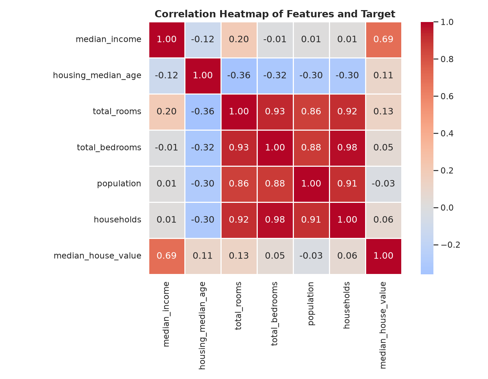
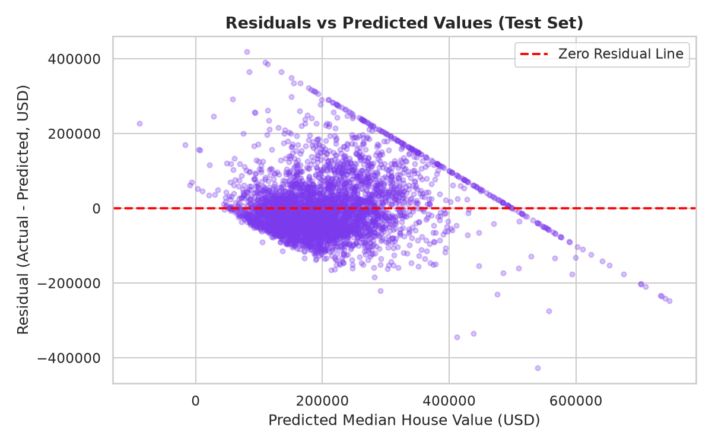
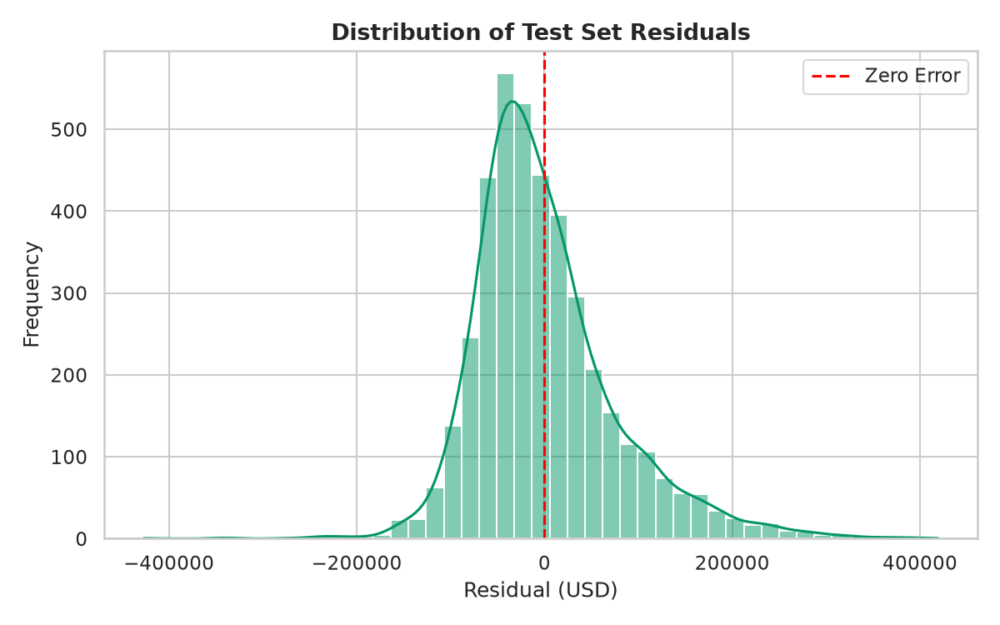

# RCA CIE 2 Activity 1: Multiple Linear Regression — California Housing Price Prediction

**Subject:** Regression and Classification Algorithms (RCA) — CIE 2 Activity 1 (Unit I)  
**Department:** AI & DS (T.Y. B.Tech)  
**Faculty Submission GitHub:** https://github.com/complexiota  
**Repository:** https://github.com/dhruv-000/RCA-CIE2-Activity1-Multiple-Linear-Regression

---

## 1. Project Overview

This repository presents a complete, end-to-end **Multiple Linear Regression** study on the California Housing dataset. Adopting the workflow of a professional data scientist, the project covers problem framing, data cleaning, exploratory data analysis (EDA), **manual Normal Equation calculations** on a 6-observation sample verified against Scikit-learn, single-feature vs. multiple-feature model comparison, residual diagnostics, Variance Inflation Factor (VIF) multicollinearity analysis, and regression assumption testing.

---

## 2. Problem Statement

Real-estate analysts and urban planners need interpretable estimates of neighborhood house prices to support housing market research and infrastructure budgeting. Given 6 numerical attributes of a California census block group—`median_income`, `housing_median_age`, `total_rooms`, `total_bedrooms`, `population`, and `households`—the objective is to predict the continuous target variable **`median_house_value`** (in USD) and understand how each feature contributes when holding the others constant.

---

## 3. Dataset Description and Source

- **Dataset:** California Housing Prices (1990 US Census, Pace & Barry 1997)
- **Source:** [Kaggle — California Housing Prices (Cam Nugent)](https://www.kaggle.com/datasets/camnugent/california-housing-prices)
- **Raw Size:** `20,640` rows × `10` columns (`data/housing.csv`)
- **Cleaned Size:** `20,433` rows × `10` columns (`207` rows missing `total_bedrooms` — ~1.00% — were removed; `0` duplicate rows)
- **Target Variable (`y`):** `median_house_value` (USD; capped at `$500,001` in the census)
- **Selected Input Features (`X`):**
  - `median_income` (tens of thousands of USD)
  - `housing_median_age` (years)
  - `total_rooms` (count of rooms in block group)
  - `total_bedrooms` (count of bedrooms in block group)
  - `population` (total residents in block group)
  - `households` (total households in block group)

---

## 4. Technologies Used

- **Python 3**
- **NumPy** & **Pandas** (numerical computing and data manipulation)
- **Matplotlib** & **Seaborn** (EDA and diagnostic visualizations)
- **Scikit-learn** (train-test split, feature scaling, Linear Regression, evaluation metrics)
- **Statsmodels** (Variance Inflation Factor / VIF computation)
- **Jupyter Notebook** (interactive analysis and reporting)

---

## 5. Project Structure

```text
RCA-CIE2-Activity1-Multiple-Linear-Regression/
│
├── data/
│   └── housing.csv
│
├── notebooks/
│   └── Activity1_Multiple_Linear_Regression.ipynb
│
├── outputs/
│   └── generated_visualizations/
│       ├── 01_target_distribution.png
│       ├── 02_feature_scatter_plots.png
│       ├── 03_correlation_heatmap.png
│       ├── 04_pair_plot.png
│       ├── 05_actual_vs_predicted.png
│       ├── 06_residuals_vs_predicted.png
│       └── 07_residual_histogram.png
│
├── src/
│   └── regression.py
│
├── .gitignore
├── README.md
└── requirements.txt
```

---

## 6. Methodology & Algorithms Implemented

1. **Data Cleaning & EDA:** Inspected types, summary statistics, missing values, and correlations.
2. **Manual OLS (Normal Equations):** Solved $\mathbf{b} = (X^T X)^{-1} X^T \mathbf{y}$ by hand/matrix algebra on a 6-row sample with `median_income` and `housing_median_age`, and verified against Scikit-learn.
3. **Train-Test Split:** 80% training (`16,346` rows) / 20% testing (`4,087` rows) with `random_state=42` to prevent data leakage.
4. **Models Trained:**
   - **Mean Baseline** (predicting training mean `$206,644.40`)
   - **Single Linear Regression** (`median_income` only)
   - **Multiple Linear Regression** (all 6 numerical features, plus `StandardScaler` on training data for standardized coefficient comparison)
5. **Diagnostics:** Test-set MAE, MSE, RMSE, $R^2$, Adjusted $R^2$, residual plots, VIF multicollinearity check, and linear regression assumptions assessment.

---

## 7. Actual Model Results

### Manual OLS Verification (6-Observation Sample)

| Parameter | Manual Normal Equations | Scikit-learn `LinearRegression` |
| :--- | ---: | ---: |
| `b0` (Intercept) | `125,635.9161` | `125,635.9161` |
| `b1` (`median_income`) | `26,774.5776` | `26,774.5776` |
| `b2` (`housing_median_age`) | `1,336.8329` | `1,336.8329` |

### Test-Set Model Comparison (`n = 4,087`)

| Model | MAE (USD) | MSE | RMSE (USD) | $R^2$ | Adjusted $R^2$ |
| :--- | ---: | ---: | ---: | ---: | ---: |
| **Mean Baseline** | `$92,836.50` | `1.3676e+10` | `$116,946.10` | `-0.0001` | `-0.0003` |
| **Single Linear Regression** (`median_income`) | `$63,374.55` | `7.2210e+09` | `$84,976.53` | `0.4720` | `0.4718` |
| **Multiple Linear Regression** (6 features) | `$56,642.50` | `5.8656e+09` | `$76,587.33` | `0.5711` | `0.5704` |

### Multiple Linear Regression Equation

$$\widehat{\text{median\_house\_value}} = -45,966.35 + 47,698.97(\text{median\_income}) + 1,880.90(\text{housing\_median\_age}) - 19.89(\text{total\_rooms}) + 104.98(\text{total\_bedrooms}) - 33.63(\text{population}) + 116.32(\text{households})$$

### Multicollinearity (VIF on Training Set)

| Feature | VIF | Interpretation |
| :--- | ---: | :--- |
| `total_bedrooms` | `33.98` | Severe multicollinearity |
| `households` | `31.99` | Severe multicollinearity |
| `total_rooms` | `11.69` | Severe multicollinearity |
| `population` | `5.96` | Moderate-to-high multicollinearity |
| `median_income` | `1.51` | Low multicollinearity |
| `housing_median_age` | `1.16` | Low multicollinearity |

### Sample New Prediction (In-Range Input)
For `median_income = 4.5` (`$45,000`), `housing_median_age = 25`, `total_rooms = 2,200`, `total_bedrooms = 420`, `population = 1,100`, `households = 400`:
- **Predicted Median House Value:** **`$225,581.72` USD**

---

## 8. Important Visualizations

| Correlation Heatmap | Actual vs Predicted |
| :---: | :---: |
|  |  |

| Residuals vs Predicted | Residual Distribution |
| :---: | :---: |
|  |  |

---

## 9. How to Run the Project

### Locally (Ubuntu Linux / VS Code)

```bash
git clone https://github.com/dhruv-000/RCA-CIE2-Activity1-Multiple-Linear-Regression.git
cd RCA-CIE2-Activity1-Multiple-Linear-Regression
pip install -r requirements.txt

# Run the standalone Python pipeline
python3 src/regression.py

# Or open and run the Jupyter Notebook
jupyter notebook notebooks/Activity1_Multiple_Linear_Regression.ipynb
```

### Google Colab
Upload `notebooks/Activity1_Multiple_Linear_Regression.ipynb` to Google Colab. The notebook automatically falls back to downloading `housing.csv` from GitHub if `../data/housing.csv` is not present locally.

---

## 10. Conclusion

Multiple Linear Regression improved test $R^2$ from `0.4720` (single-feature `median_income`) to `0.5711` (6 features) and reduced RMSE from `$84,976.53` to `$76,587.33`. `median_income` is the strongest driver of California house prices, while block-group count features (`total_rooms`, `total_bedrooms`, `households`, `population`) exhibit high multicollinearity (VIF > 5). Future improvements include engineering per-household ratios, incorporating geographic location (`latitude`, `longitude`, `ocean_proximity`), and testing regularized or non-linear models. This 1990 census block-group model provides statistical estimates only and should not be used for individual property appraisals or automated lending decisions.
