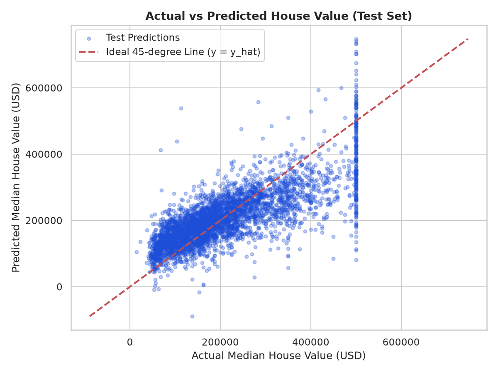

# RCA CIE 2 Activity 1: Multiple Linear Regression

**Student Name:** Dhruv Gosavi  
**Roll No.:** AD3162 | **Division:** A  
**Subject:** Regression and Classification Algorithms (RCA) — CIE 2 Activity 1 (Unit I)  
**Department:** AI & DS (T.Y. B.Tech)  
**Faculty GitHub:** https://github.com/complexiota  
**Repository:** https://github.com/dhruv-000/RCA-CIE2-Activity1-Multiple-Linear-Regression

---

## Project Overview

This project implements **Multiple Linear Regression** on the California Housing dataset as part of CIE 2 Activity 1. It covers dataset inspection and cleaning, exploratory data analysis (EDA), manual Normal Equation calculations on a 6-row sample (verified with Scikit-learn), single-feature vs. multiple-feature model comparison, residual diagnostics, VIF multicollinearity checks, and linear regression assumptions.

## Problem Statement

The goal is to predict **`median_house_value`** (in USD) for California census block groups using 6 numerical features:
- `median_income` (tens of thousands of USD)
- `housing_median_age` (years)
- `total_rooms` (count)
- `total_bedrooms` (count)
- `population` (count)
- `households` (count)

## Dataset Description and Source

- **Dataset:** California Housing Prices (1990 US Census)
- **Source:** [Kaggle — California Housing Prices](https://www.kaggle.com/datasets/camnugent/california-housing-prices)
- **Raw Size:** `20,640` rows × `10` columns (`data/housing.csv`)
- **After Cleaning:** `20,433` rows (`207` rows with missing `total_bedrooms` removed; `0` duplicates)

## Technologies Used

- Python 3
- NumPy, Pandas
- Matplotlib, Seaborn
- Scikit-learn, Statsmodels
- Jupyter Notebook

## Project Structure

```text
RCA-CIE2-Activity1-Multiple-Linear-Regression/
│
├── data/
│   └── housing.csv
├── notebooks/
│   └── Activity1_Multiple_Linear_Regression.ipynb
├── outputs/
│   └── generated_visualizations/
├── src/
│   └── regression.py
├── .gitignore
├── README.md
└── requirements.txt
```

## Methodology & Algorithms Implemented

1. **Data Cleaning & EDA:** Checked missing values, duplicates, distributions, scatter plots, correlation heatmap, and pair plot.
2. **Manual OLS Calculation:** Solved $(X^T X)\mathbf{b} = X^T \mathbf{y}$ on a 6-row sample using `median_income` and `housing_median_age`, and verified against Scikit-learn.
3. **Train-Test Split:** 80% train (`16,346` rows) / 20% test (`4,087` rows) with `random_state=42`.
4. **Models:** Mean Baseline, Single Linear Regression (`median_income`), and Multiple Linear Regression (all 6 features).
5. **Diagnostics:** Test MAE, MSE, RMSE, $R^2$, Adjusted $R^2$, residual plots, and Variance Inflation Factor (VIF).

## Evaluation Results (Test Set, `n = 4,087`)

| Model | MAE (USD) | MSE | RMSE (USD) | $R^2$ | Adjusted $R^2$ |
| :--- | ---: | ---: | ---: | ---: | ---: |
| **Mean Baseline** | `$92,836.50` | `1.3676e+10` | `$116,946.10` | `-0.0001` | `-0.0003` |
| **Single Linear Regression** (`median_income`) | `$63,374.55` | `7.2210e+09` | `$84,976.53` | `0.4720` | `0.4718` |
| **Multiple Linear Regression** (6 features) | `$56,642.50` | `5.8656e+09` | `$76,587.33` | `0.5711` | `0.5704` |

### Manual OLS Verification (6-Row Sample)
- `b0` (Intercept): `125,635.9161`
- `b1` (`median_income`): `26,774.5776`
- `b2` (`housing_median_age`): `1,336.8329`
- Matched Scikit-learn output identically.

### Fitted Multiple Regression Equation

$$\widehat{\text{median\_house\_value}} = -45,966.35 + 47,698.97(\text{median\_income}) + 1,880.90(\text{housing\_median\_age}) - 19.89(\text{total\_rooms}) + 104.98(\text{total\_bedrooms}) - 33.63(\text{population}) + 116.32(\text{households})$$

### Multicollinearity (VIF)
`total_bedrooms` (`33.98`), `households` (`31.99`), `total_rooms` (`11.69`), and `population` (`5.96`) show high multicollinearity, while `median_income` (`1.51`) and `housing_median_age` (`1.16`) are low.

### Sample New Prediction
For `median_income=4.5`, `housing_median_age=25`, `total_rooms=2200`, `total_bedrooms=420`, `population=1100`, `households=400`:
- **Predicted Median House Value:** **`$225,581.72` USD**

## Visualizations

| Correlation Heatmap | Actual vs Predicted |
| :---: | :---: |
|  |  |

| Residuals vs Predicted | Residual Histogram |
| :---: | :---: |
|  |  |

## How to Run

```bash
git clone https://github.com/dhruv-000/RCA-CIE2-Activity1-Multiple-Linear-Regression.git
cd RCA-CIE2-Activity1-Multiple-Linear-Regression
pip install -r requirements.txt

# Run the Python script
python3 src/regression.py

# Or open the Jupyter Notebook
jupyter notebook notebooks/Activity1_Multiple_Linear_Regression.ipynb
```

You can also upload `notebooks/Activity1_Multiple_Linear_Regression.ipynb` directly to Google Colab (it downloads `housing.csv` automatically if the local file is not present).

## Conclusion

Using 6 features improved test $R^2$ from `0.4720` (single feature) to `0.5711` and reduced RMSE from `$84,976.53` to `$76,587.33`. `median_income` is the main driver of house prices, while block-group count features overlap (high VIF). Future improvements include creating per-household ratio features and adding geographic location (`latitude`, `longitude`, `ocean_proximity`).
